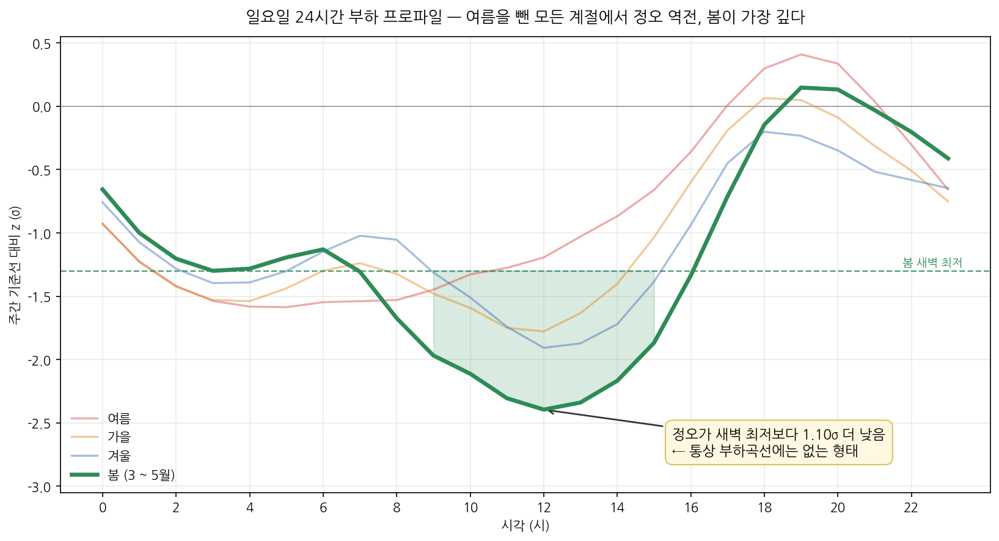
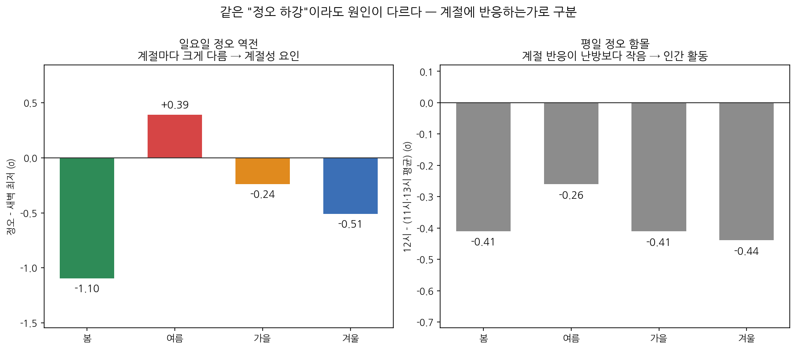
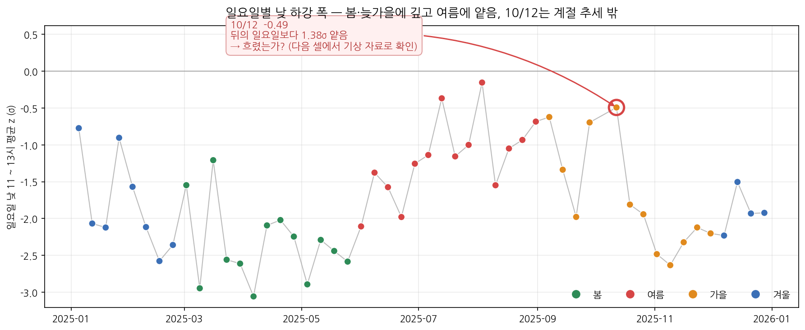

# 전력 수요 이상탐지 — 걸러낼 것과 조치할 것의 구분

전국 시간별 전력수요 데이터에서 통계적 이상을 탐지하고, 탐지된 것이 **설비 이상인지 계통의 정상 현상인지** 판별한 분석입니다.

이상탐지의 실무 가치는 탐지 자체가 아니라, **걸러낼 것(계통 현상)과 조치할 것(설비 이상)을 구분하는 판단**에 있다고 보고 그 판별 과정에 분석의 무게를 두었습니다.

---

## 데이터

**주 데이터 — 전력수요**

| 항목 | 내용 |
|---|---|
| 출처 | 한국전력거래소 · 시간별 전국 전력수요량([공공데이터포털](https://www.data.go.kr/data/15065266/fileData.do)) |
| 기간 | 2025년 전체(8,760행, 결측 0건) |
| 단위 | MW |
| 인코딩 | cp949 |

원본은 `날짜 × 24시간` 가로형이므로 `melt`로 세로형(`시각`, `사용량`)으로 변환해 사용했습니다. 열 이름 `1시`는 00시를 뜻하므로, 시각은 열 번호에서 1을 뺀 값으로 만들었습니다. 이 변환을 빼면 전 시각이 한 시간 밀립니다.

**기초 통계** — 평균 64,503MW · 최소 35,811MW · 최대 95,951MW · 부하율 67.2%(평균을 최대로 나눈 백분율)

최대부하는 8월 25일 월요일 17시로 여름 평일 오후이고, 최소부하는 5월 4일 일요일 11시로 봄 일요일 낮입니다. 두 극값의 시점이 계통 상식과 맞으므로 변환·단위 처리에 오류가 없다고 판단했습니다.

**대조 자료 — 기상**

| 항목 | 내용 |
|---|---|
| 출처 | 기상청 · ASOS 일별 자료([기상자료개방포털](https://data.kma.go.kr)) |
| 기간 | 2025년 전체(35,385행, 97지점) |
| 받는 요소 | 일조시간 · 일사량 · 평균기온 |
| 판단 근거 | 일조시간 |
| 단위 | hr · MJ/m² · ℃ |
| 인코딩 | cp949 |

대조 자료는 결과 ③에서 씁니다. 가설이 만들어낸 예측을 판정하려고 붙인 것이라 주 데이터와 쓰임이 다릅니다.

---

## 방법

168시간(1주일) **중심 이동평균**을 기준선으로 삼고, 편차가 σ의 K배를 넘는 시점을 이상으로 판정했습니다. 여기서 σ는 168시간 중심 이동 표준편차입니다. K는 실험으로 정하는 임계값이며 2.0부터 3.5까지 돌렸습니다. 편차는 168시간 이동평균 기준선에서 벗어난 양이고, z는 편차를 그 시기의 표준편차로 나눈 값입니다. 탐지는 z로 합니다. MW 그대로는 시기마다 변동 폭이 달라 어느 시점이 그 시기의 평상시에서 얼마나 벗어났는지를 계절끼리 견줄 수 없습니다. 다만 z의 분모인 표준편차도 계절마다 다르므로, 두 계절의 크기가 몇 배인지를 낼 때는 MW 축으로 냅니다. 그래서 수준을 견주는 자리에는 z를, 배수를 내는 자리에는 MW를 씁니다.

- `center=True` — 후행 평균을 쓰면 기준선이 실제 변화를 늦게 따라가면서, 정상인 시점이 이상으로 잡힙니다.
- `window=168` — 전력 수요는 24시간 주기와 요일 주기를 함께 가지므로, 요일 효과까지 기준선에 흡수시키려면 최소 1주일이 필요합니다.
- `min_periods=84` — 168시간 안에 값이 최소 몇 개 있어야 계산할지를 정합니다. 84를 고른 이유는 168의 절반이기 때문입니다. 절반 이상이 채워졌을 때만 기준선을 만들겠다는 뜻입니다. 그 결과 창 안에 들어온 값이 첫 시점 84개, 마지막 시점 85개로 양 끝에서도 조건을 채웠고, 결측은 0건이었습니다.

계절은 3 ~ 5월을 봄, 6 ~ 8월을 여름, 9 ~ 11월을 가을, 12 ~ 2월을 겨울로 묶었습니다. 계절·요일 비교에서 뺀 공휴일 19일은 1/1 · 1/27 ~ 1/30 · 3/1 · 3/3 · 5/5 · 5/6 · 6/3 · 6/6 · 8/15 · 10/3 · 10/5 ~ 10/9 · 12/25입니다.

### 임계값 실험

| 임계값 | 탐지 건수 | 하강 | 상승 | 전체 대비 | 정규분포 건수 | 실측 ÷ 정규분포 |
|---|---|---|---|---|---|---|
| 2.0σ | 169 | 140 | 29 | 1.93% | 399 | 0.42 |
| 2.3σ | 64 | 57 | 7 | 0.73% | 188 | 0.34 |
| 2.5σ | 34 | 33 | 1 | 0.39% | 109 | 0.31 |
| 2.7σ | 14 | 14 | 0 | 0.16% | 61 | 0.23 |
| 2.9σ | 8 | 8 | 0 | 0.09% | 33 | 0.24 |
| 3.0σ | 4 | 4 | 0 | 0.05% | 24 | 0.17 |
| 3.5σ | 0 | 0 | 0 | 0.00% | 4 | 0.00 |

일곱 임계값 전부에서 실측이 정규분포 건수보다 적고, 임계값이 올라갈수록 비율이 대체로 떨어집니다(0.42 → 0.00). 그러므로 σ를 확률로 읽으면 안 됩니다. 2.9σ에서 비율이 한 번 올라갑니다. 하지만 2.9σ 실측은 8건뿐이라 한 건이 늘거나 줄면 비율이 0.031 움직입니다. 실제로 올라간 폭은 0.014이며, 올라간 폭이 한 건의 영향인 0.031보다 작아서 추세를 뒤집지 못합니다. 표는 소수 둘째 자리이므로 이 비교는 반올림 전 값으로 했습니다.

2.0σ를 채택하지 않은 이유는 연간 169건, 주 3.2건을 사람이 검토해야 하기 때문입니다. 표의 399는 "이 데이터가 정규분포와 얼마나 다른가"를 보는 숫자이고, 169는 "사람이 실제로 열어봐야 하는 개수"이기에 서로 의미가 다릅니다. 3.0σ를 채택하지 않은 이유는 4건으로 규칙성을 확인할 표본이 안 되기 때문입니다. 그래서 연간 검토 부담이 감당 가능한 수준이고, 규칙성을 확인할 표본이 되는 2.5σ를 채택했습니다. 구간은 걸린 시점이 1시간 간격으로 이어지는 동안을 하나로 묶은 것입니다. 2.5σ 탐지 34건(하강 33 + 상승 1)을 구간으로 묶으면 11개(하강 10 + 상승 1)입니다. 3시간 이상 지속된 것이 하강 10구간 중 7개입니다. 상승을 포함하더라도 마찬가지로 7개입니다. 뒤쪽 임계값 견고성 표의 2.5σ 행은 하강만 센 10구간입니다. 탐지 조건은 `abs(z)`로 잡았으므로 하강뿐 아니라 상승도 걸릴 수 있습니다. 그래서 방향을 나눠 확인했습니다. 상승은 2.0σ에서 29건 · 2.3σ에서 7건 · 2.5σ에서 1건이고 2.7σ부터 0건입니다.

---

## 결과

### ① 무슨 일이 일어나는가 — 일요일 24시간 프로파일



2.5σ 하강 10구간이 전부 일요일이고, 시작 시각은 오전 9시 ~ 정오입니다.

| 시작 | 요일 | 지속 | 평균 편차 | 최대 z (σ) |
|---|---|---|---|---|
| 2025-04-06 10시 | 일 | 6h | −17,288MW | −3.11 |
| 2025-03-09 11시 | 일 | 4h | −19,783MW | −3.02 |
| 2025-05-04 09시 | 일 | 6h | −15,520MW | −2.95 |
| 2025-11-09 11시 | 일 | 3h | −16,999MW | −2.72 |
| 2025-02-16 12시 | 일 | 2h | −18,680MW | −2.69 |
| 2025-03-30 10시 | 일 | 4h | −16,102MW | −2.66 |
| 2025-05-25 10시 | 일 | 3h | −18,882MW | −2.63 |
| 2025-03-23 11시 | 일 | 3h | −17,322MW | −2.59 |
| 2025-11-02 12시 | 일 | 1h | −17,669MW | −2.59 |
| 2025-05-18 12시 | 일 | 1h | −21,020MW | −2.53 |

지속시간이 1시간인 구간이 2개 · 2시간이 1개 · 3시간이 3개 · 4시간이 2개 · 6시간이 2개입니다. 최대 지속시간은 6시간입니다.

하강 33건은 일요일 9 ~ 15시에만 있으며 유일한 상승은 화요일 오전입니다(2025-03-04 10시 · +2.62σ · 85,127MW). 상승은 한 건뿐이라 요일·시각에 쏠림이 있는지 판정할 표본이 안 됩니다. 그래서 쏠림은 하강에서만 확인했습니다.

설비 고장이 무작위로 발생한다면 요일과 시각이 이렇게 한 곳에 모일 수 없습니다. 이 시점에서 탐지 대상이 "고장"이 아니라 "현상"이라고 판단을 바꿨습니다.

특이한 것은 하강의 형태입니다. **봄 일요일은 정오 수요가 새벽 최저보다 낮습니다** — 계절 평균 곡선 기준 43,068MW(12시) 대 50,100MW(3시)로 7,031MW 낮습니다. 계절 평균 곡선은 그 계절의 같은 시각끼리 평균해 만든 24시간 곡선입니다. 새벽 최저는 0 ~ 6시 가운데 값이 가장 낮은 시각의 수요를 뜻합니다. 봄 일요일에서는 3시입니다. 일별 기준으로도 봄 일요일 13일 중 11일에서 정오가 새벽 최저보다 낮았습니다. 이렇게 뒤집힌 것을 역전이라 부릅니다. 하루 중 활동이 가장 많은 시간대의 수요가 활동이 가장 적은 시간대보다 낮습니다. 통상적인 일 부하 곡선에는 없는 형태입니다.

이 역전은 봄에만 있는 것이 아니라 **여름을 제외한 모든 계절에서 나타나며, 봄이 가장 깊습니다**(봄 −1.10σ · 여름 +0.39σ · 가을 −0.24σ · 겨울 −0.51σ). 이 값은 계절 평균 곡선에서 정오 z와 0 ~ 6시 z 최솟값의 차이이고, 음수가 역전입니다. 계절마다 크기가 많이 다르다는 점이 다음 단계의 출발점이 됩니다.

### ② 원인이 무엇인가 — 점심시간·난방·조업을 데이터로 구분한다



원인 후보를 좁히기 위한 판별 기준을 다음과 같이 세웠습니다. 계절 반응은 같은 지표를 계절별로 냈을 때 계절 사이에 벌어지는 크기 차이를 뜻합니다. 이 문서에서는 겨울 값을 여름 값으로 나눈 배수로 잽니다.

> **계절 반응이 자연 요인과 견줄 만하면 자연 요인, 그보다 작으면 인간 활동**

이 기준에 더해 각 후보가 사실이라면 나타났어야 할 것을 데이터와 대조했습니다. 검토한 후보는 아래 셋입니다.

**후보 1 — 점심시간 효과** (우측 패널)
막대는 평일 정오 함몰을 앞뒤 시각 대비 σ 기준으로 그린 것입니다. 함몰은 그 시각이 앞뒤 두 시각의 평균보다 얼마나 낮은지를 뜻하며, 음수면 그 시각이 더 낮습니다. 봄 −0.41σ · 여름 −0.26σ · 가을 −0.41σ · 겨울 −0.44σ입니다. 겨울이 여름의 1.69배입니다. 다만 이 배수는 σ 축이라 그대로 쓸 수 없습니다.

분모(표준편차)가 계절마다 다르고 여름이 가장 큽니다(봄 6,688MW · 여름 9,502MW · 가을 7,561MW · 겨울 7,875MW로 여름이 겨울의 약 1.21배). 그렇기 때문에 같은 MW 함몰이 여름에 더 작은 σ로 나옵니다. 그래서 배수는 MW 축으로 냈습니다. 분모는 168시간 중심 이동 표준편차, 평일 11 ~ 13시의 계절 평균입니다.

평일 정오는 앞뒤 시각 대비 MW 기준 봄 −2,699MW · 여름 −2,406MW · 가을 −3,022MW · 겨울 −3,417MW입니다. 겨울이 여름의 1.42배입니다.

평일 정오 함몰과 일요일 정오 함몰을 계절별로 비교해보면, 봄 −2,699MW와 −485MW · 여름 −2,406MW와 −377MW · 가을 −3,022MW와 −619MW · 겨울 −3,417MW와 −794MW입니다. 평일이 일요일의 봄 5.56배 · 여름 6.37배 · 가을 4.88배 · 겨울 4.30배입니다. 태양광의 영향은 요일을 구분하지 않는데 정오 함몰은 요일에 따라 다르게 나타납니다.

비교 대상은 난방입니다. 난방은 기온에 직접 걸린 자연 요인이며, 아침 난방 가동이 집중되는 평일 오전 8시를 그 지표로 삼았습니다. 평일 오전 8시는 앞뒤 시각 대비 MW 기준 봄 1,317MW · 여름 1,192MW · 가을 1,780MW · 겨울 3,348MW로 겨울이 여름의 2.81배입니다. 평일 정오의 계절 반응이 난방의 계절 반응보다 작습니다.

요일에 따라 차이를 보인다는 점, 계절 반응이 난방보다 작다는 점을 근거로 정오 함몰을 점심시간에 따른 인간 활동으로 판단했습니다. 그래서 원인 후보에서 배제했습니다.

**후보 2 — 겨울 난방 프로파일**
평일 겨울 8시가 +1.52σ입니다(봄 +0.79σ · 여름 +0.37σ · 가을 +0.79σ). 평일에서 겨울과 봄의 z 격차는 8시에 +0.73σ이고 정오에도 +0.50σ 남습니다. 겨울과 가을은 8시 +0.73σ에서 정오 +0.14σ로 줄지만 부호는 그대로입니다. 아침에 몰린 난방이 낮에 사라지지 않고 완만해진다는 뜻입니다. 여름은 정오에 냉방이 겹쳐 난방만 떼어 볼 수 없으므로 대조로 쓰지 않았습니다. 겨울 정오 역전(−3,879MW)은 낮에 완만해지는 난방과 따로 고려할 수 없습니다. 그러므로 겨울은 태양광 귀속에서 제외합니다.

**후보 3 — 조업 중단·설비 정지**
세 번째 후보는 앞의 두 가지와 다르게 다뤘습니다.

새벽 02 ~ 04시에는 태양광도 점심시간도 없습니다. 그럼에도 그 시각에 일요일이 평일보다 3,645 ~ 4,332MW 낮습니다.

**새벽 02 ~ 04시 요일 차** — 계절 평균 곡선 기준 · 단위 MW

| 계절 | 일요일 − 평일 | 토요일 − 평일 |
|---|---|---|
| 봄 | −3,891 | −553 |
| 여름 | −4,009 | −134 |
| 가을 | −4,332 | −606 |
| 겨울 | −3,645 | +298 |

토요일도 사무·상업은 쉬지만 새벽은 평일과 토요일이 사실상 동일합니다. 사무·상업 부하의 요일 차이는 새벽에 나타나지 않습니다. 토요일 새벽은 금요일 야간 근무에 해당하고, 일요일 새벽은 토요일 야간 근무에 해당합니다. 사무·상업을 빼면 새벽에 요일 차이를 만들 수 있는 것으로 조업이 남습니다. 그 차이는 일요일에만 나타납니다. 따라서 조업 감소는 낮에만 발생하지 않습니다.

일요일 밤(20 ~ 22시) z는 −0.54σ ~ +0.11σ이고, 낮(11 ~ 13시)은 −2.55σ ~ −0.87σ입니다. 하루 전체가 균일하게 낮아지는 것이 아닙니다. 낮이 밤보다 깊습니다.

**일요일 낮·밤 월별** — 단위 σ

| 월 | 낮 11 ~ 13시 | 밤 20 ~ 22시 | 낮 − 밤 |
|---|---|---|---|
| 1 | −1.47 | −0.46 | −1.01 |
| 2 | −2.16 | −0.45 | −1.71 |
| 3 | −2.18 | −0.14 | −2.03 |
| 4 | −2.35 | +0.09 | −2.44 |
| 5 | −2.55 | −0.02 | −2.53 |
| 6 | −1.66 | +0.11 | −1.77 |
| 7 | −0.92 | +0.04 | −0.96 |
| 8 | −0.87 | −0.08 | −0.80 |
| 9 | −1.16 | −0.31 | −0.85 |
| 10 | −1.42 | −0.20 | −1.22 |
| 11 | −2.35 | −0.36 | −1.99 |
| 12 | −1.90 | −0.54 | −1.35 |

낮은 12개월 전부 음수입니다. 밤은 9개월이 음수, 3개월(4·6·7월)이 양수입니다. 가장 깊은 밤 −0.54σ가 가장 얕은 낮 −0.87σ보다 얕습니다.

요일 차이는 하루 전체에 걸쳐 나타나지만 낮이 특히 깊습니다. 요일 차이를 만드는 것들이 낮과 밤에 같은 비로 작용한다면 낮만 이렇게 깊어질 수 없습니다. 그래서 낮에만 작동하면서 수요를 감소시키는 요인을 두었습니다. 이것은 낮과 밤의 비가 일정하다는 가정 위에 섭니다. 조업이 낮에 더 크게 빠지는지는 이 데이터로 확인할 수 없습니다. 그 요인이 요일에 영향을 받지 않는다면 평일에도 나타나야 합니다.

일요일 역전은 계절 평균 곡선의 정오에서 0 ~ 6시 최저를 뺀 값입니다. 같은 계산을 평일에도 해서 평일 성분과 요일 성분 두 가지로 나눴습니다. 평일 성분은 평일 정오에서 평일 새벽(0 ~ 6시) 최저를 뺀 값이고, 요일 성분은 일요일 역전에서 평일 성분을 뺀 값입니다. 세 값 모두 계절 평균 곡선 기준입니다. 표의 세 열은 정수로 반올림했으므로 더하면 1MW 어긋나는 계절이 있습니다.

**역전 분해** — 계절 평균 곡선 기준 · 단위 MW

| 계절 | 일요일 역전 | 평일 성분 | 요일 성분 |
|---|---|---|---|
| 봄 | −7,031 | +2,492 | −9,524 |
| 여름 | +4,137 | +16,426 | −12,290 |
| 가을 | −1,506 | +8,222 | −9,729 |
| 겨울 | −3,879 | +8,821 | −12,700 |

여름에 부호가 뒤집히는(+4,137MW) 것은 냉방 부하 증가가 태양광과 같은 시간대에 겹치기 때문으로 보이나, 냉방과 태양광은 분리할 수 없습니다. 그래서 여름은 반증 근거로도 지지 근거로도 쓰지 않고 제외해, 판별은 봄·가을·겨울 셋으로 했습니다.

역전의 크기는 요일 성분이 만듭니다. 다만 계절에 따라 움직이는 폭은 판별 대상인 봄·가을·겨울에서 평일 성분이 6,329MW, 요일 성분이 3,176MW로 1.99배 차이 납니다. 계절 차이는 평일 성분이 더 크게 만듭니다.

조업은 배제하지 않았습니다. 일요일에 빠지는 조업은 요일 성분의 일부이고, 역전의 크기를 만드는 성분으로 두었습니다. 계절에 따라 달라지는 부분만 다음 단계에서 고려했습니다.

봄의 평일 성분은 2,492MW입니다. 판별 대상 중 다른 계절은 8,222 ~ 8,821MW로 봄의 3.30 ~ 3.54배입니다. 봄은 평일 낮에 수요가 오르는 폭이 판별 대상 세 계절 중 가장 작습니다. 역전은 평일 성분과 요일 성분을 더한 값이므로, 평일 성분이 가장 작은 봄에서 역전이 가장 깊습니다.

봄이 깊은 이유가 평일 성분인지, 다른 요인인지 확인했습니다. 난방의 계절 반응은 가을이 1,780MW, 봄이 1,317MW로 가을이 봄에 비해 1.35배 큽니다. 하지만 정오 역전은 봄 −7,031MW, 가을 −1,506MW로 봄이 가을에 비해 4.67배 깊습니다. 난방이 강한 쪽에서 역전이 얕습니다. 따라서 난방은 봄이 깊은 이유가 아닙니다. 요일 성분은 봄 −9,524MW, 가을 −9,729MW로 봄이 205MW 얕습니다. 하지만 역전 차이는 5,525MW로 요일 성분 차이의 26.95배입니다. 따라서 요일 성분도 봄이 깊은 이유가 아닙니다. 앞에서 점심시간을 원인 후보에서 배제하고 겨울을 태양광 귀속에서 제외했으므로, **봄과 가을·겨울의 평일 성분 차이 중 점심시간·난방·평일 조업으로 설명되지 않는 것을 태양광 자가발전에 의한 계통 순수요 잠식으로 추정**했습니다. 순수요는 총 수요에서 계통 밖의 발전분을 뺀, 계통이 실제로 공급해야 하는 수요를 뜻합니다.

> **근거는 배제법입니다.** 기상 자료와는 대조했으나 발전실적과는 대조하지 못했습니다.

**밤 범위 견고성 확인** — 밤 범위를 19 ~ 21시로 바꿔도 **가장 깊은 상위 6개월의 순위는 완전히 일치**합니다. 다만 하위 6개월 중 2개월(1·7월)은 최대 1계단 뒤바뀝니다. 축을 바꿔 σ 대신 MW 원단위로 보면 12개월 중 8개월의 순위가 달라집니다. 그중 상위 6개월에 드는 것은 셋입니다(3월 σ일 때 3위→MW일 때 5위 · 6월 σ일 때 5위→MW일 때 4위 · 11월 σ일 때 4위→MW일 때 3위). 나머지 다섯은 아래 표에서 볼 수 있습니다. z의 분모인 표준편차가 여름에 커서 같은 MW 하강이 작은 σ로 나오기 때문입니다.

> **방향(부호)은 12개월 전부 일치하므로 결론은 유지됩니다.** 다만 "설정을 바꿔도 순위가 그대로다"라고 쓰면 틀립니다. 마찬가지로 "여름에는 현상이 거의 없다"도 MW 기준에서는 성립하지 않습니다.

| 월 | σ값 | σ순위 | MW값 | MW순위 |
|---|---|---|---|---|
| 1 | −1.01 | 9 | −7,808 | 11 |
| 2 | −1.71 | 6 | −13,516 | 6 |
| 3 | −2.03 | 3 | −13,681 | 5 |
| 4 | −2.44 | 2 | −14,824 | 2 |
| 5 | −2.53 | 1 | −16,947 | 1 |
| 6 | −1.77 | 5 | −14,161 | 4 |
| 7 | −0.96 | 10 | −9,867 | 8 |
| 8 | −0.80 | 12 | −8,282 | 9 |
| 9 | −0.85 | 11 | −7,220 | 12 |
| 10 | −1.22 | 8 | −7,832 | 10 |
| 11 | −1.99 | 4 | −14,593 | 3 |
| 12 | −1.35 | 7 | −10,496 | 7 |

이 표의 두 축은 σ와 MW입니다. σ값은 낮(11 ~ 13시) − 밤(20 ~ 22시)의 z차이를 의미하고, MW값은 같은 계산의 원단위입니다. 순위는 값이 깊은 순입니다. 방향(부호)은 12개월 전부 음수로 일치했습니다.

**임계값 견고성 확인** — 이 표는 임계값을 바꿔도 결론이 유지되는지 확인하기 위한 표입니다.

| 임계값 | 하강 구간 | 일요일 구간 | 일요일 비율 | 3시간 이상 |
|---|---|---|---|---|
| 2.0σ | 37 | 29 | 78% | 27 |
| 2.3σ | 16 | 14 | 88% | 10 |
| 2.5σ | 10 | 10 | 100% | 7 |
| 2.7σ | 4 | 4 | 100% | 3 |
| 2.9σ | 3 | 3 | 100% | 1 |
| 3.0σ | 2 | 2 | 100% | 1 |

2.5σ 탐지는 2.0σ 탐지의 부분집합입니다. 시점 단위로 상위 N건을 비교하면 결과가 이미 정해져 있으므로 구간 단위로 비교했습니다. 2.0σ는 37구간, 2.5σ는 10구간입니다. 임계값이 바뀌면 앞뒤 시간이 붙거나 떨어져 구간 경계 자체가 달라지기 때문에 구간이 다릅니다. 어느 임계값에서도 하강 구간의 다수가 일요일이고, 2.5σ 이상은 100%이며, 가장 느슨한 2.0σ에서도 78%입니다. 2.5σ를 선택해서 일요일이 나온 것은 아닙니다.

### ③ 예외는 없는가 — 기상 자료와 51일 전수로 대조한다



11월 일요일 5개는 −2.63σ ~ −2.12σ로 좁은 범위에 몰려 있습니다. 반면 10월 일요일 셋은 −0.49σ · −1.81σ · −1.94σ로 흩어져 있습니다. **10월 12일이 −0.49σ로 뒤의 두 일요일 평균(10/19 −1.81σ, 10/26 −1.94σ)보다 대략 1.38σ 얕습니다.**

10월 12일 하나만 얕은 일요일인 것은 아닙니다. 9월에도 있습니다(9/7 −0.62σ, 9/28 −0.70σ). 다만 9월은 잔여 냉방부하가 남은 계절 전이 구간이라 전반적으로 얕고 변동이 큽니다. 10월 12일은 같은 달 뒤의 두 일요일이 −1.81σ, −1.94σ인데 해당 일만 −0.49σ로, **계절 추세로 설명되지 않는 국소적 예외**라는 점이 다릅니다.

태양광이 원인이라면 이날은 흐렸어야 합니다. 즉 이 관측은 가설의 **반증 가능한 예측**에 해당합니다.

기상청 기상자료개방포털([data.kma.go.kr](https://data.kma.go.kr))의 ASOS 일별 일조시간(35,385행, 97지점, 2025년 전 기간)과 대조했습니다. 일조 결측이 167건, 일사량은 66지점에서만 관측되었습니다. 일사 결측은 12,082건입니다. 일사량이 태양광 발전 조건에 더 가까운 지표인데 사용하지 못한 것입니다. 그래서 판단 근거를 일조시간으로 두고, 그날 관측이 있는 지점만 평균을 낸 지점 평균 방식을 사용했습니다.

2025년 일요일은 52일, 그중 공휴일과 겹친 1일을 뺀 51일이 분석 대상입니다. 역전은 그날 12시 수요에서 그날 0 ~ 6시 최솟값을 뺀 값입니다. 이 값이 음수인 날을 역전일, 양수인 날을 미역전일이라 부릅니다. 51일 중 역전일은 32일입니다. 미역전일 19일은 여름에 11일 · 가을에 4일 · 봄에 2일 · 겨울에 2일로 분포되어 있습니다. 미역전일 19일은 빼지 않고 상관 계산에 그대로 넣었습니다. 역전 값을 부호 그대로 썼으므로 양수인 날도 계산에 들어갑니다. 결과 ①의 계절 평균값은 계절 평균 곡선의 정오와 새벽 최저로 계산했습니다. 위에서 정의한 일별 값과 기준이 다릅니다.

10/12, 10/19, 10/26을 차례로 비교해보면 일조시간이 각각 1.78시간 · 2.22시간 · 3.13시간입니다. 10/12는 일조시간이 2025년 하위 14.5%에 듭니다. 또한 세 날의 새벽(0 ~ 6시) 최저 대비는 각각 +5,584MW · −473MW · −2,994MW입니다. 계절 조건이 거의 같은데 일조 순서와 역전 순서가 일치합니다.

봄의 일요일 13일 중 미역전일인 3/2와 3/16에서는 각각 일조시간이 0.64시간, 2.46시간이며 2025년 하위 6.0%, 19.2%에 듭니다. 봄에서 역전이 없던 날은 이 둘뿐이고 둘 다 흐렸습니다. 태양광이 원인이라면 역전이 없던 날은 흐렸어야 한다는 예측이 여기서 맞았습니다.

월내편차는 각 월의 평균을 뺀 값입니다. 역전과 일조 둘 다 같은 방식으로 계산했습니다. 그래서 계절 요인이 지워집니다. 앞서 정의한 편차(기준선 대비)와 기준이 다릅니다.

51일에서 맑을수록 역전이 깊습니다. 두 값이 함께 움직이는 정도를 나타내는 단순 r 값이 봄 −0.920 · 여름 −0.626 · 가을 −0.881 · 겨울 −0.942입니다. 여름도 관계의 방향은 같지만 다른 계절보다 약합니다. 앞에서 여름을 판별에서 뺀 사유는 냉방과 태양광이 같은 시간대에 겹쳐 분리할 수 없다는 것입니다. 관계가 약한 것은 그 사유와 어긋나지 않습니다.

같은 계산을 평일과 토요일에도 했습니다.

| 요일 | n | 단순 r | 월내편차 r |
|---|---|---|---|
| 평일 | 244 | −0.493 | −0.676 |
| 토요일 | 51 | −0.410 | −0.805 |
| 일요일 | 51 | −0.553 | −0.822 |

세 요일의 월내편차 r은 −0.676에서 −0.822 사이입니다. 일요일에만 나타나는 현상이 아니며, 이는 요일을 구분하지 않는 태양광의 성질과 어긋나지 않습니다.

역전은 정오에서 새벽 최저를 뺀 값이므로, 정오가 내려가거나 새벽이 올라가도 깊어집니다. 어느 쪽인지 나눠서 확인했습니다. 평일 새벽 최저와 일조의 월내편차 r은 +0.028, 평일 정오는 −0.613입니다. 기온을 통제해도 정오는 −0.611입니다. 새벽에는 관계가 없고 정오에만 나타납니다.

기온 통제는 정오 수요와 일조에서 일별 평균기온으로 설명되는 부분을 뺀 뒤, 남은 값끼리 비교한 것입니다. 맑은 날은 기온도 함께 오르므로, 기온이 두 값을 함께 움직여 만든 관계를 제외합니다. 아래 표의 r²은 역전 폭의 흩어짐 중 일조로 설명되는 비율입니다.

| 계절 | n | 단순 r | 월내편차 r | r² |
|---|---|---|---|---|
| 봄 | 13 | −0.920 | −0.915 | 0.837 |
| 여름 | 14 | −0.626 | −0.674 | 0.454 |
| 가을 | 12 | −0.881 | −0.871 | 0.759 |
| 겨울 | 12 | −0.942 | −0.920 | 0.846 |
| 전체 | 51 | −0.553 | −0.822 | 0.675 |

단순 r과 월내편차 r을 나란히 두는 이유는 계절 요인을 지워도 값이 유지되는지 보기 위함입니다. 전체 행의 단순 r은 −0.553으로 계절별 값보다 얕지만 월내편차 r은 −0.822로 깊어집니다. 계절마다 역전 수준이 달라 51일을 한 덩어리로 놓으면 계절 간 차이가 섞이지만 월 평균을 빼면 사라지기 때문입니다.

단순 r과 월내편차 r의 차이는 계절별로 0.005 ~ 0.048입니다. 월 평균을 빼도 값이 이만큼밖에 움직이지 않으므로, 월 단위로 변하는 요인이 만든 관계가 아닙니다.

잔차는 일조와 역전의 회귀직선에서 벗어난 양입니다. 정규성 검정에 쓰입니다. 앞의 편차는 168시간 이동평균 기준선을 기준으로 재고, 잔차는 회귀직선을 기준으로 잽니다. 둘은 기준이 다릅니다. 피어슨 상관의 p값을 구하려면 이 잔차가 정규분포여야 한다는 전제가 있고, 전제가 깨지면 그 p값을 사용하지 못합니다.

결과는 검정마다 정규성 판정이 달라집니다. 유의수준 α = 0.05일 때, p < α라면 정규성을 기각합니다. 반대로 p ≥ α라면 정규성을 기각하지 못합니다. 따라서 Shapiro p = 0.011인 경우 정규성을 기각했고, D'Agostino p = 0.104인 경우 정규성을 기각하지 못했습니다. 그래서 정규분포를 가정하는 방법 대신 순열검정을 사용했습니다. 재현 조건은 `default_rng(0)`로 두었습니다.

일조와 역전의 짝을 무작위로 섞어 5,000번 상관을 냈습니다. 관측값은 전체 51일 월내편차 r = −0.822이고, |r| ≥ 0.822가 나온 경우는 0건입니다. 짝을 흩뜨리면 관측만큼 강한 관계가 한 번도 나오지 않았습니다. 그래서 이 관계를 우연으로 보지 않았습니다.

봄의 단순 r을 미역전일 이틀이 만든 것 아닌가에 답하려고 그 이틀(3/2, 3/16)을 빼고 다시 냈습니다. 결과는 −0.920에서 −0.894가 되었습니다. 표본 수가 13일에서 11일로 줄었습니다. 즉, 두 날을 빼도 값이 크게 변하지 않았습니다. 이것은 51일 전부를 쓴 본 계산과 별개인 확인용입니다.

**지점 민감도** — 값은 전체 51일의 월내편차 r

| 지점 수 | 중앙값 | 최솟값 | 최댓값 | 5 ~ 95% | 음수 비율 |
|---|---|---|---|---|---|
| 5 | −0.791 | −0.873 | −0.505 | −0.840 ~ −0.695 | 100% |
| 10 | −0.808 | −0.869 | −0.651 | −0.843 ~ −0.742 | 100% |
| 20 | −0.816 | −0.860 | −0.706 | −0.841 ~ −0.773 | 100% |
| 50 | −0.820 | −0.849 | −0.770 | −0.835 ~ −0.801 | 100% |
| 97(관측) | −0.822 | — | — | — | — |

97지점 단순 평균이 지점 구성에 얼마나 의존하는지 확인하기 위해 그중 k개를 무작위로 뽑아 상관을 계산했습니다. 추출 조건은 비복원 5,000회, `default_rng(0)`입니다. 대상 상관은 전체 51일의 월내편차 r입니다. 표의 `5 ~ 95%`는 재표본 5,000개를 값 순으로 늘어놓았을 때 아래에서 5% 자리와 95% 자리의 값입니다. 결과는 5,000회씩 k 네 값에서 뽑은 20,000개 재표본이 전부 음수로 부호가 유지됐으며, 크기는 일정하지 않았습니다. k=5의 최댓값 −0.505가 k 네 개 중 가장 얕습니다. 또한 k가 커질수록 재표본 중앙값이 관측값 −0.822에 가까워졌습니다. 이 방법으로는 어느 지점의 영향인지 답할 수 없습니다. 설비 용량 가중은 용량 데이터가 없어 할 수 없습니다.

---

## 한계

- **배제법 기반 추정입니다.** 태양광 발전량 실측을 결합하지 않았으므로 인과를 확인한 것이 아닙니다.
- **두 성분이 독립이라고 가정했습니다.** 역전을 평일 성분과 요일 성분으로 나눌 때 둘이 서로 영향을 주지 않는다고 보았습니다. 그래서 평일 조업은 배제하지 못했습니다. 조업이 계절에 따라 달라지는 부분이 있으면 그 부분도 평일 성분에 들어가, 태양광 귀속으로 계산됩니다.
- **요일 차이의 낮·밤 비가 일정하다고 가정했습니다.** 낮이 밤보다 깊다는 것을 낮에만 작동하는 요인으로 다룰 때 이 가정을 썼습니다. 조업이 낮에 더 크게 빠지는지는 이 데이터로 확인할 수 없습니다.
- **총량 데이터입니다.** 상별 전류·무효전력·역률이 없어 설비 단위의 이상은 원리적으로 탐지할 수 없습니다. 계통 수준 현상만 다룹니다.
- **태양광 자원 지표입니다.** 설비 용량으로 가중하지 않았기에 현재의 지표는 전국 97개 지점의 단순 평균입니다. 그래서 일조시간이 실제 발전 조건을 얼마나 대표하는지 알 수 없습니다. k를 5·10·20·50으로 바꿔 뽑은 재표본이 전부 음수이므로 지점 구성이 달라져도 방향은 유지됩니다. k=5에서 최댓값인 −0.505로 가장 얕아지므로 크기는 흔들립니다.
- **2025년 1개 연도입니다.** 연도 간 태양광 설비 증설 추세와 대조하지 못했으므로 "매년 반복되는 현상"이라고 말할 근거는 없습니다.
- **공휴일은 계절·요일 비교에서만 제외했습니다.** 공휴일은 조업이 없어 산업부하가 빠지므로 평상시와 부하 구성이 다릅니다. 그래서 계절별·요일별 평균 곡선과 상관 계산에서는 19일을 뺐습니다. 다만 기준선·z·임계값 실험과 2.5σ 탐지 34건은 8,760시간 전체로 계산했습니다. 두 곳의 표본 범위가 다릅니다.

---

## 이 분석에서 판단이 바뀐 지점

봄 일요일 정오는 기준선 대비 −15,728MW, 앞뒤 시각 대비 −485MW입니다. 같은 현상인데 기준을 바꾸면 32.4배 차이가 납니다. 태양광 발전이 정오 한 시각에만 몰리지 않고 11시와 13시에도 비슷한 강도로 이어진다고 보면 세 시각이 함께 내려갑니다. 이것은 이 데이터로 보인 것이 아니라 발전 특성에서 가져온 전제입니다. 앞뒤 시각 대비로 재면 그 차이가 0에 가까워집니다. 그래서 이 지표로는 태양광의 유무를 판정할 수 없습니다.

| 단계 | 처음 생각 | 데이터가 말한 것 | 바뀐 결론 |
|---|---|---|---|
| 탐지 | 설비 이상을 찾는다 | 하강 33건이 전부 일요일 낮 | 핵심은 탐지가 아니라 **판별** |
| 해석 | 정오 역전 = 태양광 | 겨울 역전은 난방과 따로 고려할 수 없음 · 평일 성분에 점심시간·난방·평일 조업이 남아 있음 | 태양광은 **평일 성분 차이에 대한 추정**까지만 |
| 해석 | 겨울이 가장 깊으니 태양광이 아니다 | 11시·12시·13시가 같이 내려가면 앞뒤 차이가 0에 가까워진다 | 이 지표로는 태양광을 판정할 수 없다 |
| 해석 | 밤에 나타나지 않으니 조업이 아니다 | 새벽 02 ~ 04시에도 일요일만 평일보다 3,645 ~ 4,332MW 낮고, 토요일은 −606 ~ +298MW로 평일과 같은 수준 | 조업은 배제하지 않고 **성분을 나눈다** |

정오 역전을 태양광으로 본 것이 특히 중요합니다. 오리 곡선은 태양광이 낮에 순수요를 감소시켜 만드는 곡선의 모양을 뜻합니다. 일요일 곡선 하나만 보고 "오리 곡선이니 태양광"으로 결론냈다면 틀린 분석이 됐을 것입니다. 평일이라는 대조군을 확인한 것이 오류를 막았습니다.

---

## 파일 구성

```
power-demand-anomaly-detection/
├── 전력이상탐지.ipynb          # 전 과정(데이터 로드 → 기상 자료 대조), 47셀
├── figures/
│   ├── 01_sunday_profile.png
│   ├── 02_discrimination.png
│   └── 03_sunday_scatter.png
└── README.md
```

노트북은 Google Colab 기준입니다. 한글 폰트가 필요하므로 0장 준비 절의 `fonts-nanum` 설치 셀을 먼저 실행해야 합니다. 두 CSV는 각각 공공데이터포털과 기상청 기상자료개방포털에서 받아야 합니다. 기상 자료는 일조시간·일사량·평균기온을 2025년 전 기간·전체 지점으로 받습니다. 일사량은 판단 근거로 쓰지 않지만 노트북이 결측 건수를 세므로 함께 받아야 합니다. `/content/drive/MyDrive/` 최상위에, `한국전력거래소_시간별 전국 전력수요량_20251231.csv`와 `ASOS_2025_일자료.csv`를 두어야 합니다. 기상 자료는 드라이브에 두기 전에 이 이름으로 바꿉니다. 또한 노트북이 경로를 직접 읽으므로 둔 뒤에는 파일명을 바꾸면 안 됩니다. `figures/` 폴더는 0장 준비 절이 만들고, 그래프 3장은 각 그림 셀이 그 안에 저장합니다. 폴더가 어디에 만들어지는지는 0장 준비 절이 실행할 때마다 경로로 출력합니다.
